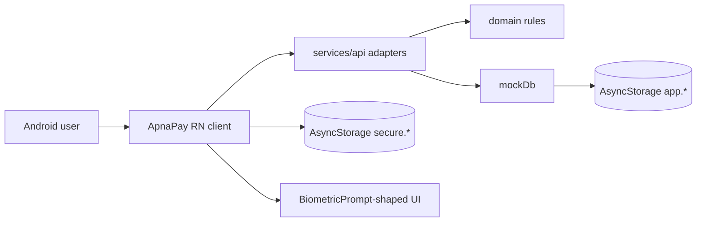
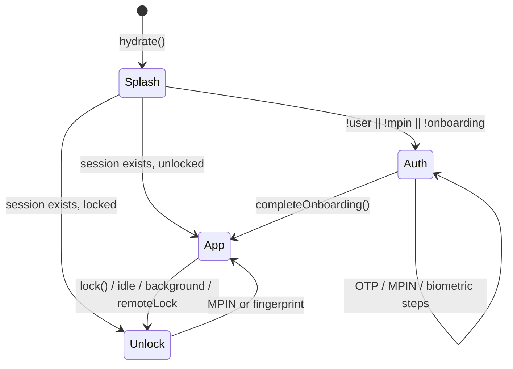
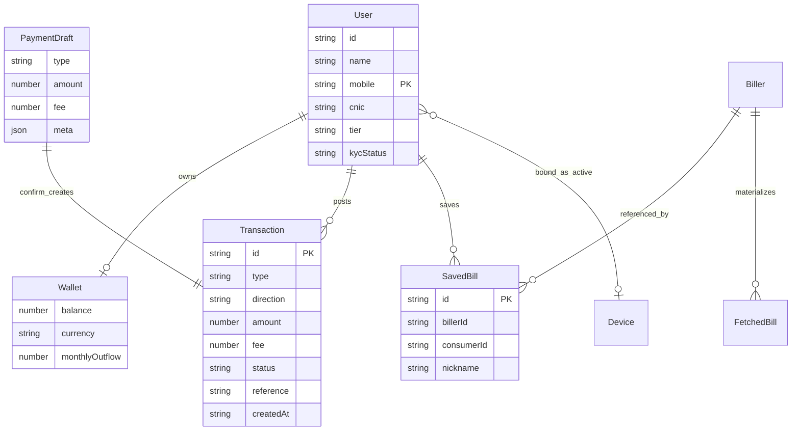
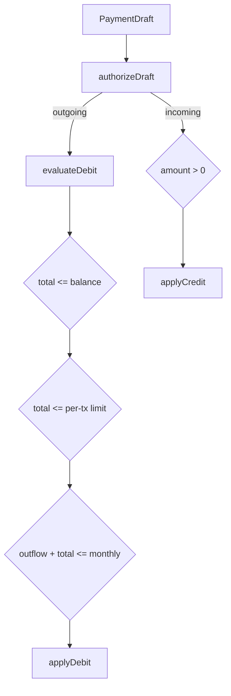
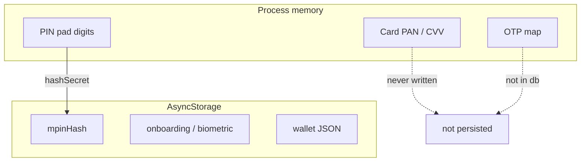
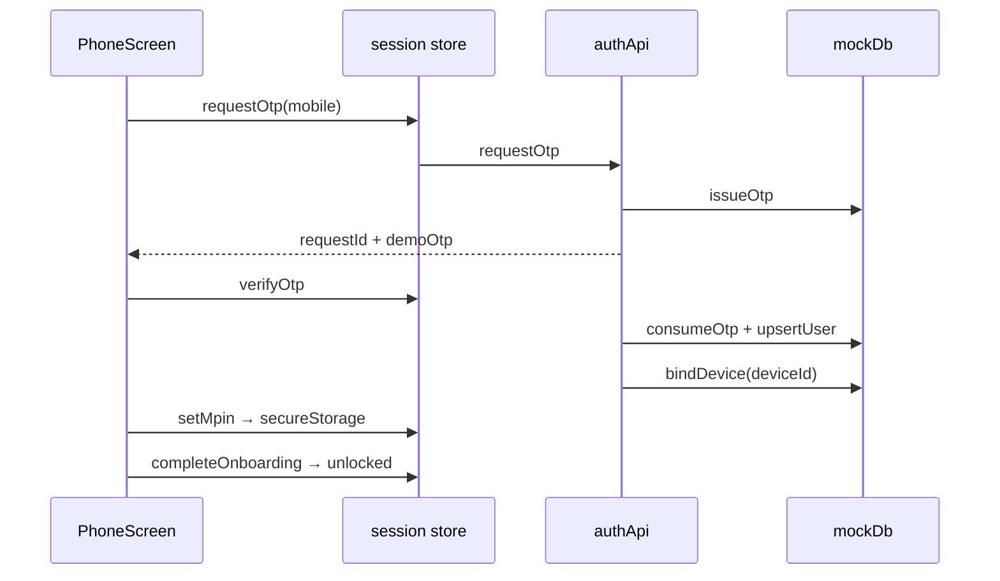
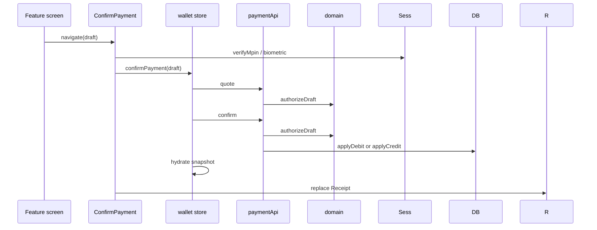

# Architecture

Technical design of the **ApnaPay Android demo** in this repository. Product contract (what we ship, mocked rails, acceptance) lives in [`PRD.md`](./PRD.md). **Quick outline only:** [`architecture-essentials.md`](./architecture-essentials.md).

---

## 1. Context

ApnaPay is a single-device React Native wallet. There is **no server in this demo**. Screens talk to TypeScript adapters that simulate network latency and coded errors, then mutate an in-memory + AsyncStorage `mockDb`.



Production keeps the same arrows, but `services/api` becomes HTTPS and `secureStorage` / `biometricService` become Keystore + `BiometricPrompt`.

**System boundary:** `com.apnapay` on Android API 24+. iOS scaffolding is unused.

---

## 2. Design goals

| Goal | How it shows up |
| --- | --- |
| UI stays dumb | Screens collect input, navigate, render `ErrorText`. No paisa math, no limit checks. |
| Rules are pure | `src/domain` has zero React / Zustand / Navigation imports. |
| Rails are swappable | `authApi`, `paymentApi`, `walletApi`, `kycApi`, `catalogApi` are the HTTP façade. |
| Failures are coded | Every adapter returns `ApiResult<T>`; stores `unwrap()`. |
| Money is exact | Wallet math is integer paisa, then converted back to rupees for display. |
| Android-first | Keyboard avoiding `height`, fingerprint copy, no iOS product paths. |

---

## 3. Tech stack

### Runtime

| Piece | Version / choice | Role |
| --- | --- | --- |
| React Native | `0.87.1` | UI runtime (New Architecture app template) |
| React | `19.2.3` | Components |
| TypeScript | `^6` | Strict types, path alias `@/*` → `src/*` |
| Node | `>= 22.11.0` | Tooling |
| Android | `minSdk 24`, `compileSdk 37`, `targetSdk 36`, Kotlin `2.2.0` | Host app `com.apnapay` |

### App libraries

| Library | Role |
| --- | --- |
| `@react-navigation/native` + native-stack + bottom-tabs `7.x` | Typed navigation |
| `react-native-screens` / `gesture-handler` / `safe-area-context` | Native stack + insets |
| `zustand` `5.x` | Session + wallet stores |
| `@react-native-async-storage/async-storage` | Persistence behind storage ports |
| `react-native-svg` + `react-native-qrcode-svg` | Icons + receive QR |

### Tooling

| Tool | Role |
| --- | --- |
| Metro + `@react-native/metro-config` | Bundler |
| Babel `module-resolver` | `@/` imports in JS |
| Jest + `@react-native/jest-preset` | Domain / util tests |
| ESLint (`@react-native/eslint-config`) + Prettier | Style |
| Gradle / Kotlin Android plugin | Native build |

**Deliberately not used:** Redux, React Query, Axios, native biometric SDK, MMKV, SQLite. Two Zustand stores and a mock API are enough for a local demo; extra libraries would imply a backend that does not exist.

---

## 4. Layered architecture

```
┌─────────────────────────────────────────────┐
│  App.tsx  —  ErrorBoundary, SafeArea, GH    │
├─────────────────────────────────────────────┤
│  app/navigation  —  root gate + stacks      │
├─────────────────────────────────────────────┤
│  features/*  —  screens (product surfaces)  │
│  shared/*    —  UI kit                      │
├─────────────────────────────────────────────┤
│  store/*     —  session + wallet façade     │
├─────────────────────────────────────────────┤
│  services/api     — adapters + mockDb       │
│  services/storage — secure / app ports      │
│  services/biometrics                        │
├─────────────────────────────────────────────┤
│  domain/*    — money, debit, MPIN, Result   │
│  utils/*     — parse, format, validate      │
│  types/*     — shared models                │
│  config/demo — limits, fees, timeouts       │
└─────────────────────────────────────────────┘
```

### Dependency rule

```
features  →  store | shared | services/api (read-only catalog) | domain | utils | types
store     →  services | domain | types
services  →  domain | utils | types | config
domain    →  types | config   (no React, no I/O)
```

`domain` must stay unit-testable in Node. If a rule needs `AsyncStorage` or a hook, it is in the wrong layer.

### Folder map

```
src/
  app/navigation/     Root, Auth, App navigators + param lists
  config/             DEMO, LIMITS, FEES
  domain/             money, paymentRules, mpinPolicy, result
  features/           auth, home, send, receive, bills, load, cash,
                      payments, history, kyc, account
  services/api/       client (withLatency), index (adapters), mockDb
  services/storage/   keys, appStorage, secureStorage
  services/biometrics/
  shared/components/  Screen, Button, PinPad, MpinSheet, SessionGuard, …
  store/              useSessionStore, useWalletStore
  theme/
  types/
  utils/
```

---

## 5. Navigation architecture

One root native stack, **mutually exclusive** screens — not a nested auth overlay.



| Navigator | Screens |
| --- | --- |
| `RootStack` | `Auth` \| `Unlock` \| `App` |
| `AuthStack` | Welcome → Phone → Otp → CreateMpin → BiometricOptIn |
| `AppStack` | `Tabs` + SendMoney, ConfirmPayment, Receipt, Bills, MobileLoad, AddCash, Kyc, TransactionDetail |
| `MainTabs` | Home, History, QR, Account |

`SessionGuard` wraps `AppStack` only. Param lists are in `src/app/navigation/types.ts`; screens use `AuthProps<'Otp'>` / `AppProps<'SendMoney'>`.

Shared money path (every send, bill, load, cash-in):

```
Feature screen
  → PaymentDraft
  → ConfirmPayment
  → MpinSheet (PIN or fingerprint)
  → paymentApi.quote → paymentApi.confirm
  → Receipt
```

---

## 6. State management

Two Zustand stores. No global “god store.”

### Session (`useSessionStore`)

In-memory flags + orchestration for auth/KYC/device.

| Field | Source | Persisted? |
| --- | --- | --- |
| `user` | `mockDb.snapshot().user` | yes (`db`) |
| `hasMpin` | presence of `SECURE_KEYS.mpinHash` | yes (secure) |
| `onboardingComplete` | secure flag `'1'` | yes (secure) |
| `biometricEnabled` | secure flag `'1'` | yes (secure) |
| `deviceId` | `APP_KEYS.deviceId` | yes (app) |
| `unlocked` | process only | no — always false after cold start |
| `lastActivityAt` | `touch()` / unlock | no |
| `mpinAttempts` / `mpinLockedUntil` | `evaluateMpinAttempt` | no (resets on hydrate) |
| `remoteLock` | user exists && `!authApi.isActiveOnThisDevice` | derived |

### Wallet (`useWalletStore`)

Read model of `mockDb`. `confirmPayment` is quote-then-confirm, then `hydrate()` so Home/History see the new ledger.

Screens subscribe to **slices** (`s => s.user`) to avoid whole-store rerenders.

---

## 7. Data models

Canonical TypeScript types: `src/types/index.ts`. The demo “database” is `DbState` in `mockDb`.



### Core entities

**User** — one per device in this demo. `tier` is `unverified | verified`. `kycStatus` includes `pending | rejected` for a production-shaped enum; the demo only writes `none` or `verified`.

**Wallet** — singleton. `balance` and `monthlyOutflow` are rupees with two-decimal precision, stored as numbers but **mutated only** via `addMoney` / `subtractMoney`. Currency is always `PKR`.

**Transaction** — immutable ledger row. `direction` is `in` \| `out`. `type` discriminates product rail. `meta` is a string map (mobile, IBAN, last4, billerId, …) so receipts stay generic. `status` allows `pending | failed` for a future adapter; confirm currently always writes `success`.

**PaymentDraft** — uncommitted intent assembled by a feature screen. Confirm does not trust the screen for limits: `authorizeDraft` runs again on quote and confirm.

**SavedBill** — consumer bookmark. Unique on `(billerId, consumerId)`.

**FetchedBill** — ephemeral 1LINK-shaped payload (amount due derived from consumer id). Not persisted except by converting to a `PaymentDraft`.

**Catalog (static)** — `Bank`, `Biller`, `Bundle`, `CashAgent`, `WalletContact`. Not user-editable.

**OtpRecord** — in-memory only (`Map`). `requestId` + mobile + 5 minute expiry. Survives neither process death nor `reset()`.

### Enumerations

| Name | Values |
| --- | --- |
| `AccountTier` | `unverified`, `verified` |
| `KycStatus` | `none`, `pending`, `verified`, `rejected` |
| `TransactionType` | `wallet`, `ibft`, `cnic`, `bill`, `load`, `bundle`, `postpaid`, `add_card`, `add_agent`, `request` |
| `TransactionDirection` | `in`, `out` |
| `TransactionStatus` | `success`, `pending`, `failed` |
| `BillCategory` | `electricity`, `gas`, `water`, `internet`, `landline` |
| `TelcoNetwork` | `jazz`, `telenor`, `zong`, `ufone` |

Incoming types (`isIncomingType`): `add_card`, `add_agent`, `request`. Credits skip debit limits and do not increase `monthlyOutflow`.

### Result type

```ts
type ApiResult<T> =
  | { ok: true; data: T }
  | { ok: false; error: { code: string; message: string } };
```

`unwrap` throws `Error` with `name = code`. UI maps via `toErrorMessage`.

### Navigation payloads (not persisted)

| Screen | Params |
| --- | --- |
| Otp | `{ mobile, requestId, demoOtp }` |
| SendMoney | optional `{ preset?: { mobile, name?, amount? } }` |
| ConfirmPayment | `{ draft: PaymentDraft }` |
| Receipt / TransactionDetail | `{ transaction: Transaction }` |

QR payload (string, not a TS type): `apnapay://pay?m=<mobile>&n=<name>&a=<optional>`.

---

## 8. Persistence

Two prefixes so “secret” and “app” can be swapped independently.

| Port | Prefix | Keys | Production target |
| --- | --- | --- | --- |
| `secureStorage` | `apnapay.secure.` | `mpinHash`, `biometricEnabled`, `onboardingComplete` | EncryptedSharedPreferences / Keystore |
| `appStorage` | `apnapay.app.` | `deviceId`, `db` | ordinary app storage or DataStore |

`db` JSON shape is `DbState`:

```ts
{
  user: User | null
  wallet: Wallet
  transactions: Transaction[]
  savedBills: SavedBill[]
  deviceId: string
  activeDeviceId: string | null
}
```

`mockDb.init()` is idempotent and runs inside `withLatency` and session `hydrate`. OTP map is **not** in `db`.

MPIN is never stored in plaintext: `hashSecret(pin, deviceId)` (FNV-1a, demo-only — not a KDF).

---

## 9. Adapter design

`src/services/api/index.ts` is the bounded context API.

| Adapter | Responsibility |
| --- | --- |
| `catalogApi` | Sync lists: banks, billers, agents, bundles |
| `authApi` | OTP issue/verify, `bindDevice`, takeover, `isActiveOnThisDevice` |
| `kycApi` | Name + CNIC → verified user |
| `walletApi` | Snapshot + delayed refresh |
| `paymentApi` | lookupWallet, fetchBill, saveBill, fetchPostpaid, quote, confirm |

`withLatency`:

1. `mockDb.init()`
2. Sleep 420–860 ms
3. Run work; unexpected throws become `{ ok: false, code: 'UNEXPECTED' }`

`authorize(draft)` loads current user + wallet and calls `authorizeDraft`. Quote and confirm both use it (idempotent check, not two extra charges — confirm is the only writer).

Debit writer: `applyDebit` subtracts `amount + fee` from balance and adds that total to `monthlyOutflow`. Credit writer: `applyCredit` adds `amount` only (fees on cash-in are 0).

---

## 10. Domain engine

| Module | Job |
| --- | --- |
| `money.ts` | `toPaisa` / `fromPaisa`, add, subtract, compare |
| `paymentRules.ts` | `evaluateDebit`, `authorizeDraft`, `isIncomingType` |
| `mpinPolicy.ts` | Attempt counter, lock window, user-facing messages |
| `result.ts` | `ok`, `fail`, `asError`, `unwrap` |

Limits and fees are data in `src/config/demo.ts`, not hardcoded in screens.



---

## 11. Security architecture (demo)



- Card PAN/CVV exist only in `AddCashScreen` state. Receipts keep `last4` + `expiry`.
- Fingerprint: UI replica of Android BiometricPrompt. `biometricService.isAvailable()` is a port (`true` in demo).
- Single-device: `activeDeviceId` on `DbState`. Mismatch ⇒ `remoteLock` until MPIN on this phone rebinds.
- Session: backgrounding locks; idle 3 min locks; 30 s warning must call `touch()`.
- `ErrorBoundary` isolates render failures from wiping `mockDb`.

This is **not** a PCI or Keystore design. Call that out in reviews; the ports exist so a production PR can replace bodies without touching features.

---

## 12. Key sequences

### Onboarding



### Payment



---

## 13. Error handling

| Layer | Mechanism |
| --- | --- |
| Domain / API | `ApiResult` + stable `code` |
| Store | `unwrap` / `asError` |
| Screen | `toErrorMessage` + `ErrorText` (or `TextField.error`) |
| Render | `ErrorBoundary` at root |
| Session idle | modal in `SessionGuard`, not an error |

Do not `catch` and swallow in adapters. Unexpected exceptions become `UNEXPECTED` only at `withLatency`.

---

## 14. Testing strategy

| Level | What | Where |
| --- | --- | --- |
| Unit | paisa math, debit/limits, MPIN lockout, `unwrap`, IBAN, amounts, hash | `src/domain/__tests__`, `src/utils/__tests__` |
| Smoke | App renders | `__tests__/App.test.tsx` |
| Manual | Flows in `PRD.md` §15 | Android emulator / device |

No adapter tests against `mockDb` yet: the interesting branching is already in `domain`. UI is verified by walking the demo, not by snapshot sprawl.

```sh
npx tsc --noEmit
npm test -- --watchAll=false
npm run lint
```

---

## 15. Build and entry

```
index.js
  enableScreens()
  AppRegistry ← app.json name "apnaPay"
App.tsx
  GestureHandlerRootView
  SafeAreaProvider
  ErrorBoundary
  StatusBar
  RootNavigator
```

Metro resolves `@/` via Babel; `tsc` resolves `@/` via `tsconfig` paths. Both must stay in sync.

Android SDK path: `android/local.properties` (`sdk.dir`). Not committed as a universal path.

---

## 16. Decisions (short ADRs)

1. **Mock adapters, not fake buttons** — every rail goes through `quote`/`confirm` so a live API is a file swap, not a rewrite.
2. **Zustand over Redux** — two stores, no middleware need.
3. **`ApiResult` over thrown-only APIs** — screens that fetch (bills, lookup) can branch on `ok` without try/catch; writers still unwrap.
4. **Paisa integers** — fees + 0.1 + 0.2 style bugs are unacceptable in a wallet demo.
5. **AsyncStorage for “secure”** — interview devices should run without extra native modules; the port documents the real target.
6. **Android-only product** — `ios/` may remain from RN init; no Pods, no Face ID, no iOS scripts.
7. **Catalog in code** — banks/billers/bundles are constants. A CMS/API would replace `catalogApi` bodies.

---

## 17. Evolving toward production

| Seam | Replace with |
| --- | --- |
| `services/api/*` | OpenAPI client, auth bearer, idempotency keys on confirm |
| `mockDb` | gone; server is source of truth; local cache optional |
| `secureStorage` | EncryptedSharedPreferences + Keystore |
| `biometricService` | `androidx.biometric.BiometricPrompt` native module |
| `hashSecret` | no local PIN hash; server (or TEE) verifies |
| `ReceiveScreen` scan | Camera + ML Kit / vision-camera |
| `monthlyOutflow` | server-calculated period, not a client counter |

Until then, treat `PRD.md` as the product contract and this file as the map of the client.
